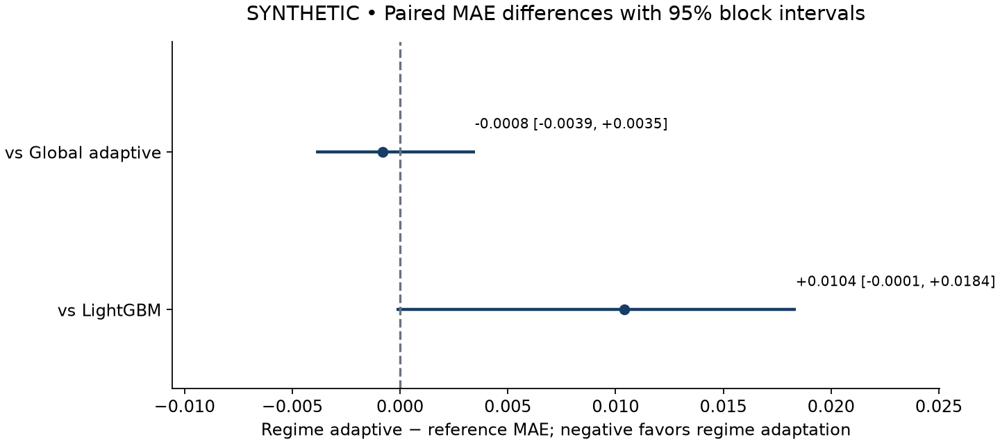

# RegimeShift ML Research and Engineering Guide

Purpose, construction, methods, technologies, development barriers, and worked examples

Version 0.1.0 • 12 October 2026 • Prepared for the project owner and technical reviewers

## 1 What the project is for

RegimeShift-ML is a reproducible experiment for a specific question: **does information about recent market conditions help us choose better weights for forecasting models?** It compares two frozen experts, Ridge regression and LightGBM, against several ways of combining them. The project measures prediction accuracy on later dates, records what the system knew at each decision, and makes its results inspectable.

The first implementation is complete and has passed synthetic validation. Its initial synthetic experiment does not establish an advantage for regime-aware weighting. LightGBM alone achieved a final mean absolute error of 0.724831, compared with 0.735236 for regime-aware weighting. The uncertainty intervals for the two main comparisons both include zero. A negative or inconclusive finding is a valid research outcome; the purpose is to answer the question honestly.

This guide explains the original idea, the structure that was actually built, the full experiment process, the responsibilities of each technology, and the problems encountered while implementing and verifying it. It includes calculations and runnable examples so that a reader can move from the concept to the code. Results in this guide come exclusively from generated data. The real Optiver study remains pending permitted access and use.

### The motivating problem

A model trained on one distribution may perform poorly when relationships change. For example, a linear relationship between order imbalance and the forecast target might describe one period reasonably well, while a nonlinear relationship describes another. A fixed model keeps using the same learned mapping. An adaptive ensemble can change how much it trusts each existing model after observing their recent errors.

There are two distinct questions. First, does recent performance information improve the blend compared with a fixed choice? Second, does grouping that performance by a causally available market context add value beyond recent performance alone? Comparing only an adaptive system with a weak linear baseline would not separate these effects. The project therefore includes a strong static reference and a global adaptive control.

### What success means

Success means that another reader can reconstruct the data split, model choices, prediction sequence, permitted label reveals, and metric calculations. It does not mean the adaptive system must win. A persuasive positive finding would require improvement over the tuning-selected static reference and additional evidence against the global adaptive control. A synthetic result can validate software behavior, but cannot establish financial forecasting value.

The system predicts a supplied numerical target. It does not place orders, build positions, estimate transaction costs, or calculate trading profit. Its prediction intervals describe historical residual behavior; they are not a portfolio risk model. There is no dashboard, hosted service, brokerage connection, neural network, or automatic expert retraining in this release.

## 2 From the initial idea to the first construction

The original concept combined financial forecasting, deep learning, regime detection, uncertainty estimation, and adaptive model selection. That was a useful direction, but changing all of those components at once would make a result difficult to interpret. If performance improved, it would be unclear whether the gain came from a new expert, additional features, more recent training data, or regime conditioning.

The first release narrows the intervention to **adaptive weights over frozen experts**. Ridge supplies a linear baseline; LightGBM supplies a nonlinear tabular baseline. Three training-fitted clusters summarize daily market context. The comparison changes the weighting rule while preserving the experts, scoring rows, chronology, and feature definitions. Neural models and retraining remain possible later experiments rather than implied capabilities.

### The initial structural decisions

The implementation is a standalone Python package, not a collection of notebook training cells. A command line coordinates the workflow. Modules separate ingestion, features, fitted models, regime assignment, replay, statistics, and presentation. This makes the chronology testable without starting Jupyter and lets the notebook consume exactly the same saved results used by the report.

Date-partitioned Parquet is the data boundary. JSON records configurations and audit metadata. Parquet stores predictions and diagnostic tables. Joblib preserves trusted local fitted objects and replay state. Generated data and experiment artifacts stay in ignored directories. The Git repository contains the reusable program, tests, configurations, the clean notebook template, and deliberately selected synthetic aggregate documentation.

The construction can be understood as six connected stages: define the chronology and artifact contract; validate and prepare data; build causal features and frozen experts; implement delayed feedback and weighting; add statistical evaluation; then exercise the whole workflow and inspect its reports. This is a retrospective explanation of the construction, not a claim that every component was written in one uninterrupted pass.

### The package layout

```text
regimeshift-ml/
  pyproject.toml             package and command definition
  uv.lock                   exact dependency resolution
  configs/                  demo and Optiver experiment settings
  src/regimeshift/
    data.py                 validation, partitions, fingerprints
    features.py             causal row and daily features
    models.py               frozen Ridge and LightGBM experts
    regimes.py              training-fitted daily clustering
    adaptation.py           discounted losses and interval buffers
    replay.py               predict, save, queue, reveal protocol
    pipeline.py             development and final evaluation
    evaluation.py           aligned metrics and block bootstrap
    reporting.py            figures, reports, notebook generation
    synthetic.py            controlled generated data
    config.py               explicit defaults and validation
    utils.py                serialization and provenance helpers
    cli.py                  public command line
  tests/                    statistical and chronology checks
  notebooks/research.ipynb   clean artifact-reading notebook
  docs/                     this guide and synthetic aggregates
  data/                     local input and prepared data, ignored
  runs/                     local experiments, ignored
```

The main flow is input → validation → causal features → training and tuning → frozen state → sequential evaluation → saved metrics → report and notebook. A second feedback path connects yesterday's recorded predictions and newly revealed labels to today's weights and residual history. That path never refits the experts.

## 3 Technologies and how they are used

The scientific environment is Python 3.11, managed by uv. The initial verified environment used Python 3.11.9. Exact package versions are recorded in each run as well as resolved in the lockfile. Broad version ranges in `pyproject.toml` express supported dependency families; `uv sync --locked` installs the committed resolution.

| Technology | Responsibility in this project | Concrete use |
|---|---|---|
| Python 3.11 and uv | Runtime, package installation, reproducibility | Install the locked environment and invoke the CLI |
| Polars and Parquet | Typed data preparation and partitioned storage | Validate keys, join exact lags, load selected dates |
| PyArrow | Columnar ecosystem support | Available alongside the Parquet data stack |
| NumPy and SciPy | Numerical arrays and sparse matrices | Expert blends, softmax, quantiles, Ridge design matrices |
| scikit-learn | Linear models and preprocessing | Ridge, median imputation, scaling, stock encoding, K-means |
| LightGBM | Nonlinear tabular forecasting | Frozen trees with an absolute-error objective |
| threadpoolctl | Bound native CPU parallelism | Limit BLAS and scientific library worker counts |
| PyYAML | Human-editable experiment settings | Read the development configuration |
| JSON and Joblib | Audit metadata and trusted local state | Persist selections, model objects, and replay checkpoints |
| Matplotlib | Static research figures | Daily errors, weights, intervals, and comparisons |
| Jupyter tools | Executable research companion | Read saved results, execute cells, export HTML |
| pytest and Ruff | Verification and code checks | Leakage tests, hand calculations, lint and import checks |
| Git and GitHub | Source history and distribution | Version code, configurations, tests, and documentation |

PyArrow is included in the columnar stack, but the current application calls Polars for its Parquet reads and writes. It does not directly construct Arrow tables. Likewise, the document authoring tools used to produce the Word guide are separate from the scientific runtime; Word is not required to run an experiment.

### Why Polars and Parquet

Typed columns and explicit joins make the identity of each observation visible. Partitioning by date allows development to select training, tuning, and calibration data without loading final dates into model selection. Parquet also avoids repeatedly reparsing the source CSV. This implementation still materializes selected frames in memory, so partitioning does not make it a fully streaming or out-of-core trainer.

For example, after a demo has run, this reads a saved result without fitting anything:

```python
from pathlib import Path
import polars as pl

run = Path("runs/demo")
metrics = pl.read_parquet(run / "evaluation/metrics.parquet")
print(metrics.select("model", "count", "mae").sort("mae"))
```

### Why two different experts

Ridge offers a regularized linear mapping and a clear baseline. LightGBM can learn nonlinear thresholds and interactions among tabular features. Their difference makes adaptive weighting meaningful in principle, but does not guarantee useful diversity. If one expert is worse in nearly every context, adding some weight to it can make the ensemble worse.

Ridge receives median-imputed numerical features, missingness indicators, standardized inputs, and a sparse one-hot representation of stock identity. LightGBM handles missing numerical values natively and receives a stock category mapping fitted on training data. Unseen stock identities are handled without learning categories from the future. Both models use auction time as an observable input; anonymized date identifiers remain metadata.

### Why a notebook that does not train

A separate training implementation inside a notebook can drift away from the CLI. Here the notebook loads saved metrics and figures through the reporting module. Its conclusions are computed from the selected run, so pointing it at another experiment does not retain hard-coded claims from an earlier one. Notebook execution and HTML export provide a readable research artifact without creating a second source of model logic.

## 4 Data validation and causal feature construction

The real-data adapter expects an Optiver-style table with `date_id`, `stock_id`, `seconds_in_bucket`, imbalance size and direction, matched size, reference/near/far/bid/ask prices, bid and ask sizes, WAP, and target. Additional source columns are ignored. The unique observation key is the combination of date, auction second, and stock.

The importer checks required columns, numeric conversion, nonnegative integer keys, unique keys, timestamps from 0 to 540 in ten-second increments, infinite values, price and size constraints, and imbalance direction values. It rejects crossed bid/ask quotes. It normalizes missing numerical values, sorts the records, records missingness, and writes date partitions through a staging directory. The manifest fingerprints the input and every partition so that later changes can be detected.

### Missing labels are different from missing history

If a row's target is missing, its observable market features may still be useful. Deleting that row would change later lag and rolling features. The project keeps the row in the feature history and excludes its label from model fitting and scoring. It never substitutes zero for an unknown target. Input imputation is fitted on training features, including observable inputs of unlabeled training rows; supervised fitting uses only finite training targets.

A whole date with no usable labels contributes no expert loss and no scored rows. Time still advances: discounted histories decay and old residual dates can expire. This prevents an empty date from looking like a day on which every model made perfect predictions. Evaluation fails clearly if the entire final block has no finite targets.

### Worked feature example

Suppose reference price is 100, bid is 99.99, ask is 100.01, bid size is 600, and ask size is 400. The relative spread is `10000 × (100.01 − 99.99) / 100 = 2` basis points. The order-book size imbalance is `(600 − 400) / (600 + 400) = 0.2`. Combined displayed liquidity is transformed as `log(1 + 600 + 400)` to compress its scale.

If the current WAP is 100.02 and the exact WAP ten seconds earlier was 100.00, the ten-second WAP change is `10000 × (100.02 / 100.00 − 1) = 2` basis points. These are illustrative numbers. The imported dataset's prices may use normalized units, so ratios are more meaningful than treating every price column as a currency quotation.

The feature set also includes signed auction imbalance, imbalance relative to matched plus imbalance size, log matched size, and WAP/mid/near/far prices relative to reference. A denominator close to zero produces a missing feature rather than infinity. The model-specific missing-value path handles it later.

### Exact lags and rolling observations

Ten-, thirty-, and sixty-second WAP returns use exact timestamp joins within the same stock and date. If the ten-second observation is absent, a twenty-second observation cannot silently serve as a ten-second lag. This matters when rows are missing: shifting six rows is not necessarily the same as moving sixty seconds into the past.

The six-observation WAP standard deviation and spread mean use currently observable and earlier rows. They reset at every stock/day boundary. They are explicitly observation windows, not claims of a fixed elapsed-time window. At the first observation of a new day, yesterday's final observation does not become today's previous auction snapshot.

Numerical features are generally stored as Float32 to reduce memory. Observation keys retain their integer types. This distinction was important during validation: keys are identities used for exact joins, and should not be treated as approximate numerical features even when auction time is also supplied to a model.

## 5 The chronological research protocol

Complete dates are sorted and divided into 60% training, 10% tuning, 10% calibration, and 20% final evaluation. Boundaries use the floor of 60%, 70%, and 80% of the number of dates. At least 50 dates are required. The split is persisted before fitting, and all observations from a date remain in its assigned block.

| Block in the 160 date demo | Dates | Permitted purpose |
|---|---:|---|
| Training | 0 to 95 | Fit preprocessing, experts, clusters, target scale |
| Tuning | 96 to 111 | Choose expert settings, fixed blend, adaptive settings |
| Calibration | 112 to 127 | Forward prediction residuals with frozen choices |
| Final evaluation | 128 to 159 | Measure frozen-policy performance sequentially |

Randomly mixing rows would put closely related observations from the same auction session on both sides of the evaluation boundary. Whole-date splitting makes the future-prediction question clearer and prevents within-session target overlap from crossing a split. It does not remove all temporal dependence; the statistical analysis still treats dates as dependent blocks.

### Fitting and selection

Training data fit the Ridge preprocessing, LightGBM stock mapping, both experts, the daily-summary imputer and scaler, and the three K-means clusters. The loss normalization scale is the training mean absolute target, with a small positive floor. Nothing in tuning, calibration, or final evaluation refits those transformations.

Tuning chooses Ridge alpha from 1, 10, and 100; LightGBM leaf count from 15 and 31; a fixed Ridge blend weight from 0 to 1 in steps of 0.05; and adaptive half-life and temperature. Each adaptive candidate starts with equal weights and no training residual history. Selection scores the actual blended predictions, because the MAE of a mixture cannot generally be recovered by averaging the experts' MAEs.

The chosen policy is replayed through tuning to reconstruct its state, then continues through calibration. Calibration is not another model selection period. The strongest static reference is selected using tuning scores among zero, Ridge, LightGBM, and the fixed blend. Choosing the reference after inspecting final results would bias the research comparison.

### What happens at a daily boundary

At the start of date 128 in the demo, date 127's queued labels become eligible. The system evaluates the experts' recorded date 127 predictions, updates the appropriate loss histories, and adds eligible residuals to the interval buffer. It assigns date 128's regime from date 127's completed market summary. Then it uses the updated weights and current observable features to predict date 128.

Those predictions are written before date 128's targets enter the outcome queue. The targets cannot change date 128's weights. They can affect date 129 only through the already specified reveal and update rule. This is an offline next-observed-date assumption, not a guarantee about the timing of a live market feed. Gaps in anonymized date IDs do not imply a known count of elapsed trading days.

Earlier final-period outcomes may influence later final-period weights. That is the intended sequential evaluation. What remains frozen is the algorithm, its selected settings, the fitted experts, preprocessing, and clusters. The last date's labels are scored but never used to make a further forecast.

## 6 Regimes and adaptive model weights

Daily context is summarized using median spread, median absolute book imbalance, median log liquidity, and variability of observed ten-second WAP changes. Training-only imputation and standardization precede three-cluster K-means. Today's cluster assignment uses yesterday's completed summary. Cluster IDs are arbitrary labels, not validated names such as a bull market or crisis.

Using yesterday's context creates a deliberate delay. It may work when context persists across dates, but it can miss a change that begins this morning. Using today's full daily summary to make this morning's predictions would be a different experiment with future information. The first release does not claim intraday change-point detection.

### Discounting daily errors

For each expert, calculate the revealed day's MAE over its finite-target rows and divide by the training target scale. One day contributes one normalized loss to the adaptation history, regardless of how many rows that day contains. The final research metric remains row weighted; daily weighting of the adaptive state is a separate design choice.

For half-life H, the decay factor is `rho = 2 ** (-1 / H)`. Every observed date multiplies all global and regime-specific loss sums and effective counts by rho. A valid revealed day then adds its loss vector and adds one to its support count. All regimes age, even while absent. H = 5 gives rho approximately 0.870551, so an old observation retains half its original weight after five updates.

The global rule uses the discounted mean errors across all revealed contexts. The regime-aware rule combines the corresponding regime mean with that global mean. With regime effective support n, the regime contribution is `a = n / (n + 5)`. This is shrinkage toward a more widely supported estimate. Five is an effective-date shrinkage parameter, not five rows or an assertion of statistical independence.

### A worked weight calculation

Assume discounted normalized global losses of `[0.8, 1.0]` for Ridge and LightGBM. Suppose the current regime has effective support 2 and corresponding losses `[0.4, 1.2]`. Then `a = 2 / 7`, and the shrunk losses are approximately `[0.685714, 1.057143]`.

At temperature 0.5, weights are proportional to `exp(-loss / 0.5)`, giving approximately `[0.678, 0.322]`. If the experts predict 1.0 and 3.0 for a row, the adaptive forecast is approximately `0.678 × 1.0 + 0.322 × 3.0 = 1.645`. Lower temperature makes the preference sharper. Before any losses are revealed, both experts receive 0.5; an unseen regime falls back to the global estimate.

This short example exercises the implemented class, with already normalized illustrative losses:

```python
import numpy as np
from regimeshift.adaptation import AdaptiveWeights

policy = AdaptiveWeights(half_life=5, temperature=0.5)
print(policy.weights(0))             # [0.5, 0.5]
policy.reveal(0, np.array([0.2, 1.0]))
print(policy.weights(0).round(3))    # [0.832, 0.168]
```

In the full replay engine, the reveal call occurs only when a prior date's queued outcome becomes eligible. The example directly calls it to demonstrate the mathematics; it is not an alternative chronology for research runs.

### Correct regime attribution

Suppose yesterday's predictions were made under regime 0 and today's assignment is regime 2. Yesterday's newly revealed losses belong to regime 0, because that is the context recorded when those predictions were made. Adding them to regime 2 would mix performance histories whenever the context changed. The event log retains both the prediction date's regime and the revealed regime so this distinction can be audited.

Half-life values 5, 10, and 20 and temperatures 0.1, 0.5, and 1.0 form nine candidate settings. Global and regime-aware policies select their settings independently on tuning predictions. The initial experiment selected half-life 5 and temperature 0.1 for both. No new settings are selected after observing final errors.

## 7 Prediction intervals and statistical comparison

Each of the six methods receives symmetric intervals centered on its own forecast. The radius is the empirical 90th percentile of absolute residuals from earlier eligible predictions, using NumPy's `higher` quantile rule. Fixed intervals use calibration residuals. Rolling intervals use residuals from the most recent 20 revealed dates. These buffers contain calibration and final-period residuals, not training fit residuals.

For a hand calculation, take absolute residuals `[1, 2, 3, 4, 5]`. At quantile 0.9, `higher` selects 5. A point forecast of 10 therefore gets the interval `[5, 15]`, of width 10. A realized target of 14 is covered and 16 is not. The small example illustrates the calculation; it is not evidence that future observations will have 90% coverage.

An empty residual buffer produces an unavailable interval rather than a radius of zero. Missing intervals do not enter coverage denominators, and support counts are reported. Empty-label dates still occupy dates in the rolling window, so old information expires even when a more recent date provides no labels. Coverage and width are reported overall and by regime.

### Row weighted MAE

The primary metric is the sum of absolute errors divided by the number of eligible rows. Suppose date A has two errors `[1, 3]` and date B has one error `[9]`. Overall MAE is `(1 + 3 + 9) / 3 = 4.333333`. Averaging daily MAEs would instead give `(2 + 9) / 2 = 5.5`, which answers a different question. The project stores daily error sums and row counts to preserve the intended metric.

Predictions and labels must have matching unique key sets. The evaluator joins on date, auction second, and stock; it does not assume matching row order. It requires finite predictions and applies the same finite-target mask to all six methods. This prevents a model from appearing better because it was scored on an easier subset.

### Paired moving block bootstrap

The two main differences are regime-aware MAE minus the tuning-selected static reference and regime-aware MAE minus global adaptive MAE. Negative differences favor the regime-aware method. Each of 2,000 seeded bootstrap resamples draws contiguous five-date blocks and combines daily error sums and counts. Using the same sampled dates for both methods preserves pairing; using the counts preserves row weighting.

The reported 95% interval comes from the 2.5th and 97.5th percentiles of those differences. The bootstrap operates on the realized prediction path. It does not refit experts, rerun hyperparameter selection, or recreate adaptive decisions inside each resample. Its uncertainty is therefore conditional on the saved experiment, and the two intervals are not a multiple-testing-adjusted discovery procedure.

Distribution shifts, dependence among observations, and limited calibration history can all make coverage depart from the nominal target. The project reports those departures rather than claiming a guaranteed conformal prediction property. Forecast intervals and bootstrap intervals also serve different purposes: the former describe a target around a forecast, while the latter describe a difference in measured model accuracy.

## 8 How to run and inspect the project

Clone the repository and run commands from its root. No Kaggle credentials are needed for the synthetic demo. Python 3.11 and uv are required; the locked environment includes the scientific libraries, while the notebook group adds the execution and presentation tools.

```powershell
git clone https://github.com/CadenzaMyFavourite/regimeshift-ml.git
cd regimeshift-ml
uv sync --locked --group notebook
uv run --group notebook regimeshift demo --execute-notebook
```

The demo generates its own Optiver-shaped fixture, prepares it, develops the frozen study, evaluates the final period, and creates its report. The public repository can be cloned without credentials. The default output is `runs/demo`; choose `--output runs/demo-2` for another run. Existing run directories are never silently overwritten.

### The five commands

| Command | Input | Outcome |
|---|---|---|
| demo | Synthetic defaults and optional output directory | Complete generated-data workflow |
| prepare | User-supplied CSV | Validated date partitions and manifest |
| develop | YAML configuration | Frozen models, selected settings, calibration state |
| evaluate | Existing development run | Sequential final predictions and statistics |
| report | Completed run | Markdown, five figures, notebook, optional execution |

For permitted real input, the sequence is:

```powershell
uv run regimeshift prepare --input "C:\path\train.csv" `
  --output data/processed/optiver
uv run regimeshift develop --config configs/optiver.yaml
uv run regimeshift evaluate --run runs/optiver-v1
uv run --group notebook regimeshift report `
  --run runs/optiver-v1 --execute-notebook
```

The example uses PowerShell continuation syntax. On other shells, put each command on one line or use that shell's continuation convention. Configuration paths are relative to the invocation directory, then saved as absolute resolved paths in the local run. Unknown configuration keys are rejected instead of being silently ignored.

### Configuration example

```yaml
dataset: data/processed/optiver
run_dir: runs/optiver-v1
seed: 42
threads: 4
lgbm_estimators: 300
lgbm_min_child_samples: 100
half_lives: [5, 10, 20]
temperatures: [0.1, 0.5, 1.0]
shrinkage_dates: 5.0
interval_coverage: 0.9
interval_window: 20
bootstrap_block: 5
bootstrap_reps: 2000
```

The default demo uses 150 trees and minimum child support 30 to keep the installation check small. These differ from the full-data defaults above. Configuration is part of the experiment definition, so changing it creates a different study rather than a cosmetic rerun. Reusing final dates after seeing their outcomes is an exploratory follow-up, even if a new directory name is used.

### Reading outputs

Open `runs/demo/report/research.ipynb` in Jupyter or read the HTML companion. The notebook shows model comparison, daily errors, model weights and regimes, interval coverage and width, and paired differences. The portable template in `notebooks/` reads saved results and can use `REGIMESHIFT_RUN` to select another completed run.

```powershell
uv run --group notebook jupyter lab runs/demo/report/research.ipynb
uv run --group notebook pytest -q
uv run ruff check .
uv build
```

If a final evaluation is interrupted, the current CLI does not resume it in place and will refuse to overwrite the existing evaluation directory. A new development run is required for another attempt. Replay-state serialization is tested, but a supported crash-recovery CLI is a future extension. Preserve failed artifacts when diagnosing an issue; do not mistake a partially written directory for a completed study.

## 9 Initial results and what they mean

The initial fixture contains 160 dates, 12 generated stock identities, and 24 observations per stock/date: 46,080 rows. It rotates three observable contexts every 12 dates, changes the target response between linear, cubic, and sinusoidal relationships, adds noise and missing labels, and introduces a modest late scale change. Labels are generated response values, not calculated future stock returns.

The final block has 32 dates and 9,169 finite-target observations. The run used seed 42 and the standard 96/16/16/32 date split. The source for the following values is the locally verified study's saved evaluation summary; a portable aggregate copy is included in `docs/synthetic-results.json`.

| Method | Final MAE in synthetic units |
|---|---:|
| LightGBM | 0.724831 |
| Fixed blend | 0.724831 |
| Regime adaptive | 0.735236 |
| Global adaptive | 0.736038 |
| Ridge | 1.371070 |
| Zero | 2.141152 |

The fixed blend chose zero Ridge weight on tuning data, so its forecasts equal LightGBM's. This is a legitimate endpoint of a convex blend, not an implementation failure. The experts did not supply enough useful complementarity for adaptation to beat the strongest static model in this experiment.

| Paired comparison | MAE difference | 95% block interval |
|---|---:|---|
| Regime minus LightGBM | +0.010405 | -0.000147 to +0.018356 |
| Regime minus global | -0.000802 | -0.003889 to +0.003474 |

Both intervals include zero. Regime conditioning has a small favorable point difference against global adaptation, but the experiment does not provide convincing evidence that this extra conditioning helps. It also does not prove that regimes can never help: the result concerns these experts, this feature set, this chronology, and this generated process.



For the regime-aware predictor, fixed intervals covered 85.5709% of eligible final targets with mean width 2.696366. Rolling intervals covered 88.9737% with mean width 2.956600. Updating residual history moved observed coverage closer to 90% while widening the intervals. These are measured tradeoffs in one synthetic run, not coverage guarantees.

The local development timer reported about 1.193 seconds, including about 0.660 seconds for expert fitting and tuning predictions. The evaluation timer reported about 0.760 seconds. These scopes exclude process startup and separate plotting/notebook work. They describe a small fixture on the development machine, not a benchmark for the full Optiver file or another computer.

A second fresh run under the same final scientific code reproduced all prediction columns across all 32 final dates and the bootstrap comparisons exactly. Independently joining saved predictions to raw prepared targets and recomputing MAE with NumPy confirmed all six reported scores. These checks support implementation reproducibility; they do not turn generated data into financial evidence.

## 10 Barriers encountered and how they were handled

### Keeping the experiment interpretable

The initial concept contained several possible research contributions at once. The response was to freeze the experts and vary their weighting policy, while keeping the global adaptive control. This made the main ablation clear. The remaining cost is limited scope: the first release cannot answer whether expert retraining or a temporal neural model would improve the result.

### Real data access and permitted use

No permitted Optiver input was available during implementation. The supplied research plan flags competition-only use and redistribution restrictions in the official rules. The project therefore provides an importer and completes synthetic validation while leaving the financial study pending. A local CSV alone does not establish permission for a separate research or publication purpose. Access and intended use must be resolved before that experiment proceeds.

### Preventing subtle information leakage

Future targets can enter an experiment through preprocessing, model selection, residual calibration, or the replay sequence. Future features can leak through full-day summaries or incorrect lag windows. The response was a whole-date split, training-only fitting, prior-day context assignment, and a prediction interface that has no current-target argument. Perturbation tests change future information and check that earlier outputs do not change.

The data files necessarily contain historical labels because this is an offline study. The protection is therefore a tested program boundary, not a physically isolated production label service. Source hashes and artifact hashes help detect accidental changes; they cannot prevent a researcher from looking at future data outside the program or repeatedly changing the study after seeing its results.

### Inconsistent numerical types in regime prediction

An early integration run encountered a K-means buffer dtype mismatch between fitting and prediction. Scientific libraries may require a consistent numerical type even when the values themselves look valid. The regime path was standardized to Float64 for both stages. The complete-study tests then exercised the fitted cluster model through subsequent dates, rather than testing clustering only in isolation.

### Observation keys accidentally treated as features

Auction time serves two roles: it is a numerical input and part of the exact observation key. An early feature conversion cast it to Float32 with other numerical features. Internal calculations could still appear correct, but an independent join against raw integer keys exposed the mismatch. Keys now retain their original integer types, and validation checks schema consistency and reconciles reported metrics against the raw prepared observations.

### A notebook that ran but did not show charts

An initial notebook execution finished without displaying the intended embedded figures. The plotting backend produced figure-object text rather than useful chart outputs. Rendered inspection caught a problem that a successful process exit did not. The notebook now explicitly activates the inline backend after importing the reporting module, and its integration check requires five embedded PNG chart outputs.

### Empty labels and scarce regime history

Missing targets and regimes with little support needed explicit semantics. Empty dates now decay histories without adding a fabricated zero loss. Sparse regime estimates shrink toward global errors; unseen regimes use global weights, and complete cold starts use equal weights. Tests cover these cases and ensure old regimes continue to decay while absent.

### Reproducibility without hiding precision changes

Changing dtype handling can slightly change numerical outputs, even with the same random seed. A seed by itself is therefore insufficient. The run records package versions and scientific source fingerprints; final evaluation verifies them against development. Exact replication was checked by running the final scientific code twice, rather than comparing different implementation revisions and calling small differences randomness.

### Local execution constraints

The machine's default Python was newer than the requested research environment. uv created an isolated Python 3.11 environment, avoiding reliance on the default interpreter. CPU and BLAS parallelism were bounded, and a GPU was unnecessary for the chosen experts. Full-data memory and runtime remain unmeasured: import and training still require materialized frames. Nonfatal Windows Jupyter event-loop warnings did not prevent notebook completion, but the tested environment is more specific than a claim of universal platform compatibility.

### The adaptive method did not win

The strongest measured static expert was LightGBM, and adaptation retained enough weight on the weaker Ridge expert to increase overall MAE. The response was to report that outcome and its uncertainty. Retuning on the final period to manufacture a positive result would undermine the study. Later experiments should make their changed hypotheses and reused data explicit.

## 11 Verification and artifact provenance

The completed verification suite contains 35 passing test cases, including parameterized invalid-input cases. Ruff passed and both a wheel and source distribution were built. The tests concentrate on chronology, statistical meaning, and integration behavior rather than merely asserting that a function returns an object.

| Verification area | What is checked |
|---|---|
| Target causality | Current and future labels cannot change earlier forecasts or same-day weights |
| Feature causality | Future input changes cannot change earlier features, regimes, or expert forecasts |
| Boundaries | Lags reset by stock/day and use exact timestamps |
| Training isolation | Fit dates remain training-only and unseen stocks are handled |
| Replay state | Prior losses use the recorded prediction regime; ordering violations fail |
| Controlled shifts | Weight responses occur after the permitted label reveal |
| Missing support | Missing labels, empty dates, sparse regimes, and stale histories behave explicitly |
| Metrics | Key alignment, shared denominators, quantiles, and bootstrap calculations match examples |
| Reproducibility | Serialized replay matches uninterrupted replay and tampering is rejected |
| Reporting | Completed runs create a notebook with five embedded charts |

The saved run is a research record. `config.json` contains resolved settings; `splits.json` lists the date blocks; `dataset.json` records input provenance; `environment.json` records versions and code fingerprints; `selection.json` records candidates and selected choices. `models.joblib` and `checkpoint.joblib` preserve the trained objects and calibration boundary state. `frozen.json` hashes the artifacts consumed by final evaluation.

Development and evaluation prediction partitions retain the observation keys, recorded regime, reveal date, point forecasts, adaptive weights, and interval radii. Event logs capture state before and after reveals. Evaluation tables record daily, overall, and regime metrics, interval diagnostics, and runtime. The final replay state is retained for audit, even though the public CLI does not offer in-place interrupted-run recovery.

Joblib objects can execute Python code when loaded and should be treated as trusted local artifacts. This project does not distribute fitted objects. Likewise, a hash proves consistency with recorded bytes, not the truth of a data source or the validity of the scientific hypothesis. The initial recorded runs predate the first Git commit; their source hashes and lockfile hash provide provenance even though their Git commit field is null.

## 12 Limits and the next research steps

The immediate missing step is a permitted real-data experiment. Once access and use are established, import the file, inspect the validation audit, measure memory and runtime, and perform development under the declared protocol. Final evaluation should then run with those choices frozen. If the real study remains unavailable, the honest project status is a completed software framework with synthetic validation and a pending financial study.

The most informative later extensions are additional predefined synthetic shift families and independently reserved real chronologies. These can test whether regimes persist long enough for a prior-day assignment to help and whether the two experts have complementary strengths. Sensitivity to cluster count, summary choices, half-life, and shrinkage should be treated as new development work, not silently selected using the first final block.

A second research release could compare frozen experts with explicit periodic retraining, using the same delayed-label contract. A later neural expert would need a fair tuning budget and matching information availability. Any attempt to connect forecasts to a trading application would additionally require executable timing, portfolio construction, transaction costs, and a separate risk and performance evaluation. None of those outcomes follows from lower forecast MAE alone.

Engineering improvements could include a supported crash-recovery command, larger-data memory profiling, broader platform checks, and automated repository checks. These are future work, not features asserted by the initial release. The existing modular boundaries make them possible without moving training logic into the notebook.

## 13 Source map and further reading

For the implementation, start with `cli.py` and `pipeline.py`, then read `replay.py` alongside `tests/test_replay.py`. Read `features.py` with `tests/test_data_features.py` to understand information timing. Read `evaluation.py` with its hand-calculated tests before interpreting the uncertainty intervals. The README is the shorter paper-style account; this guide supplies the engineering explanations and examples.

The authoritative evidence for numerical claims is the saved experiment and the reviewed synthetic aggregate extract, not a library's promotional material. The links below provide primary documentation for the tools and dataset context. Their current behavior should be checked when changing library versions or the permitted data-use assumptions.

- [Project source](https://github.com/CadenzaMyFavourite/regimeshift-ml)
- [Synthetic aggregate record](synthetic-results.json)
- [Optiver competition data](https://www.kaggle.com/competitions/optiver-trading-at-the-close/data)
- [Optiver official rules](https://www.kaggle.com/competitions/optiver-trading-at-the-close/rules)
- [uv documentation](https://docs.astral.sh/uv/)
- [Polars documentation](https://docs.pola.rs/)
- [scikit-learn Ridge documentation](https://scikit-learn.org/stable/modules/generated/sklearn.linear_model.Ridge.html)
- [scikit-learn KMeans documentation](https://scikit-learn.org/stable/modules/generated/sklearn.cluster.KMeans.html)
- [LightGBM documentation](https://lightgbm.readthedocs.io/)
- [NumPy quantile documentation](https://numpy.org/doc/stable/reference/generated/numpy.quantile.html)
- [Matplotlib documentation](https://matplotlib.org/stable/)
- [Jupyter documentation](https://docs.jupyter.org/)

All implementation descriptions and measured values in this guide refer to the initial 0.1.0 release. Examples with invented prices or loss vectors are explanatory calculations, clearly separate from the measured synthetic run and from any future financial study.
